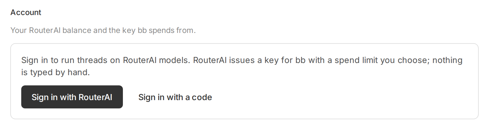
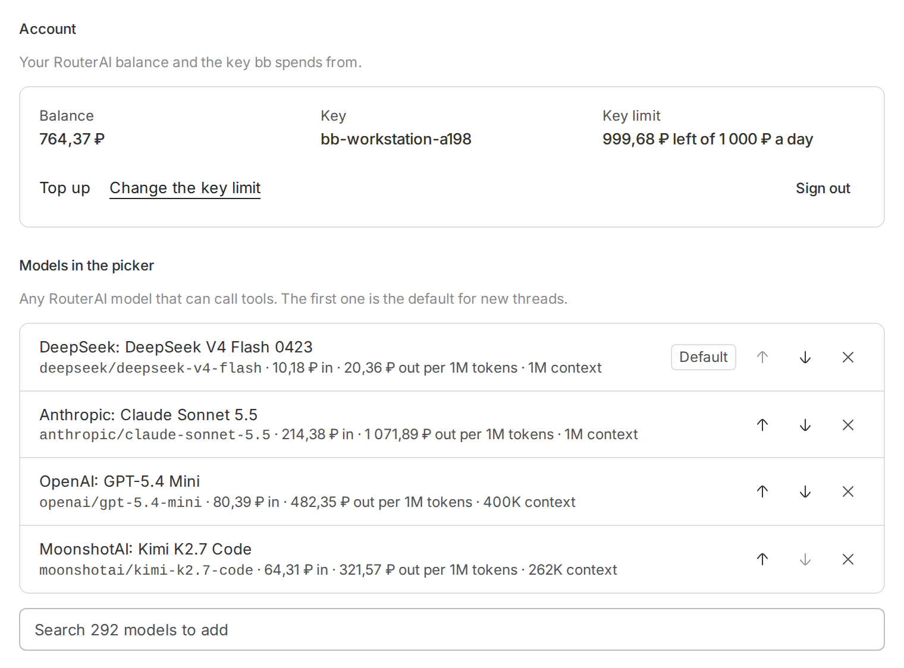
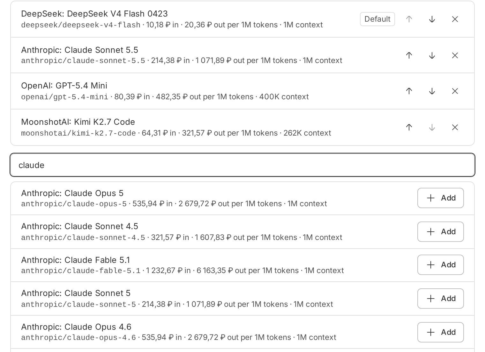
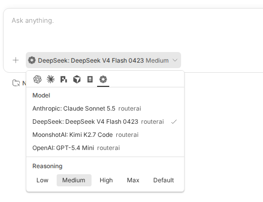
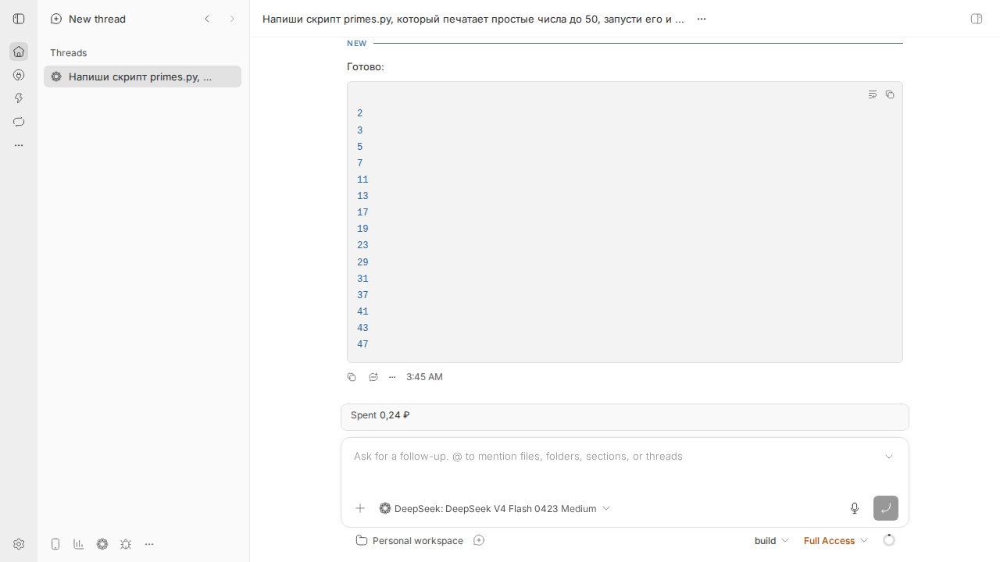
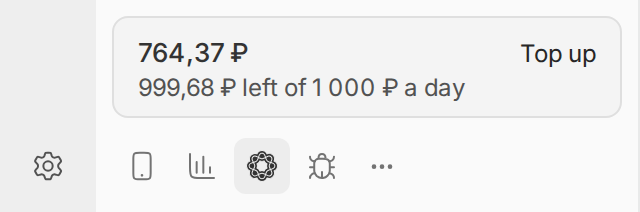
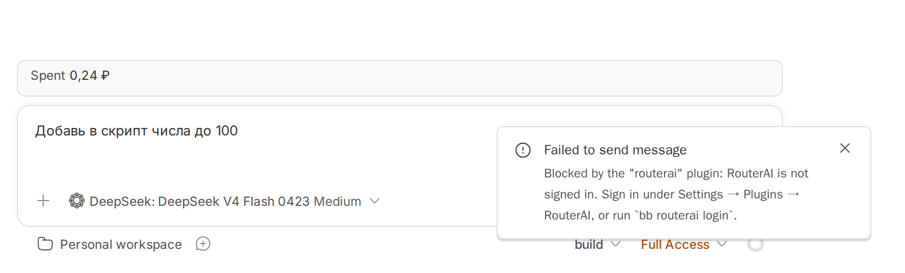

<p align="center">
  <a href="https://routerai.ru"></a>
</p>

<h1 align="center">RouterAI для bb</h1>

<p align="center">
  Claude, GPT, DeepSeek, Qwen, Kimi и сотни других моделей в тредах bb — по одному ключу, с оплатой в рублях.<br>
  Вход в один клик, баланс в боковой панели и расход каждого треда перед глазами.
</p>

<p align="center">
  <a href="https://github.com/router-ai/bb-plugin-routerai/tags"></a>
  
  
</p>

<p align="center">
  
</p>

[RouterAI](https://routerai.ru) — российский агрегатор языковых моделей: один аккаунт и один ключ вместо десятка
подписок, оплата в рублях. Этот плагин подключает его к [bb](https://getbb.app) как провайдера: треды работают
на моделях RouterAI, а агентом выступает [OpenCode](https://opencode.ai).

## Чем удобен

- **Не нужно копировать ключи.** Нажали «Sign in with RouterAI» — подтвердили доступ на routerai.ru — ключ
  сохранился сам. Лимит расходов для него задаётся там же, на странице подтверждения.
- **Деньги на виду.** Остаток на счёте — в боковой панели, расход текущего треда — над полем ввода, в рублях.
- **Весь каталог под рукой.** Около 300 моделей, умеющих вызывать инструменты, с ценами в рублях: поиск,
  свой список и порядок в выборе модели.
- **Понятные отказы.** Не вошли, ключ отозван или не установлен OpenCode — сообщение не уходит, а bb говорит,
  что сделать. Тред не падает с кодом ошибки.
- **Ключ не утекает.** Он хранится в секретах bb и в закрытом файле на машине агента; в события треда и
  настройки провайдера не попадает.
- **Claude Code на балансе RouterAI.** Один переключатель — и штатный провайдер Claude Code в bb работает на
  моделях Claude из RouterAI, без подписки Claude и со всеми своими возможностями.
- **Несколько машин — несколько ключей.** У каждой установки bb свой ключ, вход на втором компьютере
  не отключает первый.

## Установка и настройка

### 1. Установите OpenCode

Плагин запускает OpenCode как агента и сам настраивает его на RouterAI; ваши собственные настройки OpenCode
не затрагиваются. Поставьте его на машину, где bb выполняет треды:

```sh
npm install -g opencode-ai
```

Другие способы — в [документации OpenCode](https://opencode.ai/docs). Нужен bb версии 0.49 или новее.

### 2. Установите плагин

```sh
bb plugin install "git:https://github.com/router-ai/bb-plugin-routerai@>=0.1.0"
```

bb сам скачает, соберёт и запустит последнюю выпущенную версию плагина. Обновление до новой —
`bb plugin update routerai`.

### 3. Войдите в RouterAI

Откройте **Settings → Plugins → RouterAI** и нажмите **Sign in with RouterAI**.



В браузере откроется routerai.ru: выберите аккаунт, при желании измените лимит расходов ключа (по умолчанию
1000 ₽ в день) и подтвердите доступ. Ключ сохранится в bb автоматически. Аккаунта ещё нет — зарегистрируйтесь
на [routerai.ru](https://routerai.ru).

После входа на странице появятся баланс, имя ключа и остаток его лимита:



<details>
<summary>bb работает на сервере, в Docker или открыт с другой машины</summary>

После согласия routerai.ru возвращает браузер на адрес сервера bb. Если браузеру этот адрес недоступен,
страница не откроется — вход можно завершить кодом:

1. Нажмите **Sign in with a code**. На routerai.ru после согласия появится код.
2. Вставьте его в поле на странице плагина и нажмите **Finish**.

Если вы уже нажали **Sign in with RouterAI** и страница возврата не открылась, скопируйте адрес, который
пытался открыть браузер, и вставьте его в то же поле целиком.

Из терминала то же самое: `bb routerai login --manual`, затем `bb routerai login --code <код>`.

</details>

### 4. Выберите модели

Сначала в списке несколько популярных моделей. Ниже — поиск по каталогу RouterAI: добавьте нужные модели,
расставьте их по порядку стрелками, лишние уберите. Первая в списке — модель по умолчанию для новых тредов.
Цены указаны в рублях за миллион токенов: вход и выход. Кнопка **Reset** возвращает исходный набор.



### 5. Работайте

В новом треде откройте выбор модели и перейдите на вкладку **RouterAI**.



## Возможности

### Расход треда

Над полем ввода видно, сколько рублей потратил тред; сумма растёт по ходу работы. Она же — в окне контекста bb
(строка «Session cost») и в выводе `bb thread context`.



Расход считается по числу токенов, которое сообщает агент, и ценам каталога. Служебный запрос OpenCode
на заголовок сессии в него не входит, поэтому списание на routerai.ru может быть немного больше. Итоговые
списания всегда можно сверить в кабинете RouterAI.

### Баланс

Кнопка со знаком RouterAI в нижней части боковой панели показывает остаток на счёте, остаток лимита ключа
и ссылку на пополнение.



### Понятные отказы

Сообщение, на которое не получится ответить, не отправляется: текст остаётся в поле ввода, а bb показывает
причину и что с ней делать.



Так плагин отвечает, когда вход не выполнен, когда RouterAI перестал принимать ключ (его отозвали, удалили
или перевыпустили) и когда на машине не установлен OpenCode. Отозванный ключ плагин замечает по первому
неудавшемуся запросу.

### Claude Code через RouterAI

В bb есть собственный провайдер Claude Code. Плагин умеет направить его в RouterAI: модели Claude оплачиваются
в рублях с баланса RouterAI, подписка Claude не нужна. Режим план, вопросы агента, откат и остальные
возможности этого провайдера работают как обычно.

Включается на странице плагина, в разделе **Claude Code through RouterAI**, или командой
`bb routerai claude-code on`. Сам Claude Code должен быть установлен на машине, где bb выполняет треды.

Что важно знать:

- Пока режим включён, все треды на провайдере Claude Code идут через RouterAI. Чтобы вернуться к своей
  подписке Claude, выключите его.
- Личные настройки из `~/.claude` (общий `CLAUDE.md`, навыки, серверы MCP) в этом режиме не действуют:
  Claude Code запускается с отдельным каталогом настроек, из которого читает ключ RouterAI. Настройки
  из папки проекта работают.
- Расход такого треда виден над полем ввода, как и у тредов на провайдере RouterAI. Он считается по токенам,
  которые записывает bb, и ценам каталога.
- У Claude Code большой системный промпт, поэтому даже короткий запрос расходует десятки тысяч токенов.
  На старших моделях Claude это заметные деньги — следите за расходом треда.

### Свой ключ у каждой установки

RouterAI выдаёт каждой установке bb отдельный ключ с именем вида `bb-<имя машины>-<4 знака>`. По имени легко
найти нужный ключ в [кабинете](https://routerai.ru/settings/keys), а вход на втором компьютере не отключает
первый. После удаления плагина его ключ остаётся в кабинете — удалите его там же, если он больше не нужен.

## Команда `bb routerai`

```
bb routerai status [--json]          вход, баланс, лимит ключа, модели в списке
bb routerai login [--manual]         начать вход; --manual — код показывается на routerai.ru
bb routerai login --code <код|адрес> завершить вход вставкой кода
bb routerai logout
bb routerai models [--json]
bb routerai models search <текст>
bb routerai models set <slug>…       первая модель — по умолчанию
bb routerai models reset
bb routerai claude-code [on|off]     Claude Code через RouterAI: состояние, включить, выключить
```

Ключ, созданный в кабинете вручную, тоже подойдёт: `bb plugin config routerai set apiKey <ключ>`.

## Где хранится ключ

Ключ RouterAI хранится в секретах bb. На машину с агентом сервер передаёт его отдельным вызовом, и там он
лежит в файле с правами 0600 в каталоге данных плагина; OpenCode читает его оттуда сам. В настройки
провайдера, окружение треда и события треда ключ не попадает. При выходе файл удаляется.

## Совместимость

Плагин проверяется на текущей стабильной версии bb (0.49) и на ночной сборке, с OpenCode 1.19
и Claude Code 2.1, на Linux.
На macOS, Windows и в настольном приложении bb он пока не проверялся — если что-то работает не так,
[напишите](https://github.com/router-ai/bb-plugin-routerai/issues).

## Разработка

- `server.ts` — серверная часть: настройки, вход через RouterAI (OAuth PKCE), каталог моделей, регистрация
  провайдера `routerai`, проверка перед отправкой сообщения, команды `bb routerai`.
- `host.ts` — часть на машине с агентом: ACP-мост из `@get-bb/plugin-sdk`, файл ключа, расход в рублях
  и готовность провайдера.
- `app.tsx` — интерфейс: страница настроек, баланс в боковой панели, расход в треде.
- `src/routerai/` — клиент API RouterAI, разбор каталога, OAuth.
- `src/opencode-config.ts` — конфигурация OpenCode; передаётся агенту через `OPENCODE_CONFIG_CONTENT`.
- `src/spend-currency.ts` — OpenCode считает расход по рублёвым ценам, но подписывает сумму «USD»; мост
  исправляет подпись на RUB по пути в bb.
- `src/claude-code.ts` — Claude Code через RouterAI: окружение для штатного провайдера bb и расчёт расхода
  по токенам.
- `src/bridge-health.ts` — мост сообщает bb «не вошёл» или «ключ отклонён» по файлу ключа и метке рядом с ним.
- `test/` — тесты (vitest, фейковый хост из SDK).

```sh
npm install --legacy-peer-deps
npx tsc --noEmit
npx vitest run
bb plugin build .
bb plugin install /путь/к/каталогу --yes   # один раз
bb plugin reload routerai                  # после правок
```

Версия `@get-bb/plugin-sdk` в `package.json` должна быть не новее той, с которой работает ваш bb, иначе
плагин помечается несовместимым.

## Поддержка и лицензия

Вопросы и ошибки — в [issues](https://github.com/router-ai/bb-plugin-routerai/issues). История версий —
в [CHANGELOG.md](CHANGELOG.md).

Лицензия MIT, см. `LICENSE`. Базовые компоненты интерфейса (`components/ui/`, `lib/utils.ts`) взяты из
штатного шаблона плагина bb (`bb plugin new`) — MIT, © Michael Yong, см. `LICENSE.bb-upstream`.
